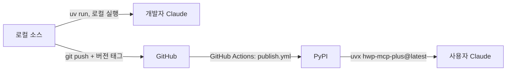

# 배포(릴리스) 가이드

이 문서는 hwp-mcp-plus를 PyPI에 배포하는 개발자(또는 에이전트)를 위한 문서다.
사용자용 설치 방법은 [README.md](../README.md)에 있다.

## 전체 구조

같은 저장소를 두 가지 방식으로 실행한다.



- **로컬 실행**: `uv run --directory <저장소 경로> hwp-mcp-plus`. 소스를 고치면 Claude를 다시 켜는 것만으로 반영된다.
- **사용자 실행**: `uvx hwp-mcp-plus@latest`. Claude를 다시 켤 때 PyPI에서 새 버전이 있는지 확인한다.
- **배포 시점**: 일반 push는 배포되지 않는다. `v`로 시작하는 태그를 push할 때만 배포된다.

## 관련 파일

| 파일 | 역할 |
|---|---|
| `pyproject.toml` | 버전, 의존성, 진입점(`[project.scripts]`), 배포 파일 목록(`[tool.hatch.build...]`) |
| `hwp_mcp_stdio_server.py` | 서버 본체. `main()`이 진입점이다 |
| `.github/workflows/publish.yml` | 태그를 push하면 빌드하고 PyPI에 배포한다 |

## 배포 절차

1. `pyproject.toml`의 `version`을 올린다. 예: `0.1.0` → `0.2.0`
   - PyPI는 같은 버전을 다시 올릴 수 없으므로 반드시 올려야 한다.
   - 버그 수정은 셋째 자리, 기능 추가는 둘째 자리, 호환성이 깨지는 변경은 첫째 자리를 올린다.
2. `uv lock`을 실행해 잠금 파일의 버전 표기를 갱신한다.
3. 배포 전에 로컬에서 확인한다(아래 "배포 전 확인" 참고).
4. 커밋하고, 태그를 붙이고, push한다.
   ```bash
   git commit -am "release: v0.2.0"
   git tag v0.2.0
   git push origin main --tags
   ```
5. GitHub 저장소의 **Actions** 탭에서 `Publish to PyPI`가 성공했는지 확인한다.

태그 번호(`v` 뒤의 숫자)가 `pyproject.toml`의 `version`과 다르면 워크플로가 배포하지 않고 실패한다.

## 배포 전 확인

```bash
uv run pytest -q          # 테스트
uv build                  # dist/ 에 wheel과 sdist 생성
```

wheel에 들어간 파일을 확인한다. 들어가야 하는 파일은 `hwp_mcp_stdio_server.py`, `src/` 아래 파일(`__tests__`는 제외), `security_module/*.dll`이다.

```bash
python -c "import zipfile,glob;print(*zipfile.ZipFile(glob.glob('dist/*.whl')[0]).namelist(),sep='\n')"
```

만든 wheel로 실제 서버가 뜨는지 확인한다. 이 명령은 다른 폴더에서 실행해야 한다. 저장소 폴더에서 실행하면 로컬 소스가 대신 import될 수 있기 때문이다.

```bash
uvx --refresh --from <저장소>/dist/hwp_mcp_plus-<버전>-py3-none-any.whl hwp-mcp-plus
```

MCP `initialize` 요청과 `tools/list` 요청을 표준입력으로 보내서 도구 목록이 돌아오면 정상이다. 확인이 끝나면 `dist/` 폴더를 지운다.

## PyPI 설정 (처음 한 번만)

이 워크플로는 Trusted Publishing을 쓴다. 그래서 API 토큰을 GitHub Secrets에 저장할 필요가 없다.

pypi.org → 계정 메뉴 → **Publishing** → **Add a new pending publisher**에 다음 값을 입력한다.

| 항목 | 값 |
|---|---|
| PyPI Project Name | `hwp-mcp-plus` |
| Owner | `greenoceanplanet` |
| Repository name | `hwp-mcp-plus` |
| Workflow name | `publish.yml` |
| Environment name | `pypi` |

워크플로 파일 이름이나 environment 이름을 바꾸면 PyPI 쪽 설정도 같이 바꿔야 한다.

## 주의사항

### 빌드 설정에서 `force-include`를 쓰지 않는다

`[tool.hatch.build.targets.wheel]`은 `only-include`로 파일을 지정한다. `force-include`를 쓰면 `uv sync`를 할 때 서버 파일이 `.venv/Lib/site-packages/`로 **복사**된다. 이 상태에서 `hwp-mcp-plus` 명령으로 실행하면 원본이 아니라 그 복사본을 읽기 때문에, 로컬에서 소스를 고쳐도 반영되지 않는다.

로컬 실행이 어느 파일을 읽는지는 다음 명령으로 확인할 수 있다. 결과가 저장소 안의 파일 경로로 나와야 정상이다.

```bash
# 저장소 밖의 폴더에서 실행
uv run --directory <저장소 경로> python -I -c "import importlib.util as u,sys;print(u.find_spec('hwp_mcp_stdio_server').origin,file=sys.stderr)"
```

### 패키지 최상위 이름이 `src`다

배포 패키지는 `src`, `hwp_mcp_stdio_server`, `security_module`을 최상위 이름으로 설치한다. uvx는 도구마다 별도의 가상환경을 쓰므로 실제로 충돌하지는 않는다. 다만 다른 패키지와 같은 환경에 함께 설치하면 `src`라는 이름이 겹칠 수 있다. 구조를 고친다면 `src/`를 `hwp_mcp_plus/` 같은 고유한 이름의 패키지로 옮기고 import 경로를 모두 고쳐야 한다.

### 로그 파일 위치

서버 로그(`hwp_mcp_stdio_server.log`)는 서버 파일과 같은 폴더에 생긴다. uvx로 실행하면 uv의 도구 가상환경 안(`site-packages`)에 생긴다.

### 사용자 업데이트 시점

`@latest`로 설정한 사용자는 배포 직후 Claude를 다시 켜면 새 버전을 받는다. 문제가 있는 버전을 배포했다면 PyPI에서 그 버전을 yank(설치 대상에서 제외)한다. 그리고 수정한 버전을 새 번호로 다시 배포한다.
